# 从零到可用：领阿里云 300 元高校学生代金券 → 创建千问 AI 平台 API Key → 接入 DSH

> 本教程是 [dsh-aliyun-balance](https://github.com/wai549077/dsh-aliyun-balance) 仓库的配套文档：
> 前半段讲怎么把券领到手、把千问 API 接进 DSH，后半段讲怎么用本插件盯住券还剩多少。

> 全流程约 10 分钟，分三段：**① 领学生券（图 1–5）→ ② 建 API Key（图 6–7、9）→ ③ 接入 DSH（图 10–13）**；**扩展（图 14–21）** 加装券 / 余额实时监看插件。（图号无 08，与截图编号一致。）  
> 前置条件：阿里云账号已完成**个人实名认证**（学生券要求账号实名人与学生认证信息一致）。

---

## 第一段：领取 300 元高校学生代金券

### 步骤 1｜从官网导航进入「云工开物」

打开阿里云官网，鼠标悬停顶部导航栏的 **①「权益」**，在展开的下拉面板中，于「普惠上云」一栏下点击 **②「云工开物」**（说明文字：高校专属算力普惠，学生认证享 300 元代金券）。

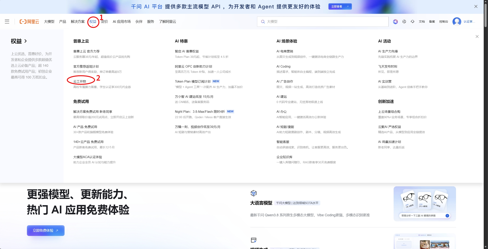

### 步骤 2｜点击「立即申请」

进入「云工开物——阿里云高校用云支持计划」首页，确认在 **「我是学生」** 标签页（左侧橙色卡片，**¥300/年 抵扣金**，标注"每日数量有限，先到先得"），点击卡片下方的橙色 **「立即申请」** 按钮。

> 这里点击之后可以根据弹出的提示完成学生认证。

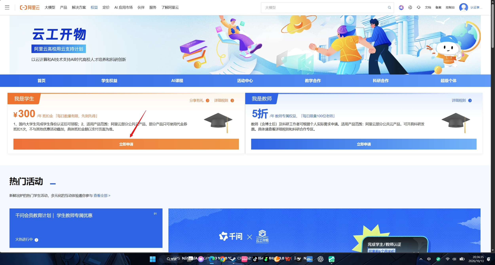

### 步骤 3｜填写学生认证表单

在「云工开物学生认证表单」页，按提示逐项填写（三项均为必填，带红色星号）：

1. **您的入学时间**：填写入学年月，务必准确——填错会导致领券不成功或领券后不能使用。
2. **您的在读学历层次**：按实际学历选择；**直博生同学请选择"硕博连读"**。
3. **您的专业**：搜索并选择所在专业，若下拉无匹配结果，选择"其他"。

再勾选下方四条条款（视为已阅读并同意）：**实名一致**、**非商业用途**（代金券仅限抵扣指定云产品费用，用于本人在校学习与科研实践，不可提现/转让/商用）、**违规处置**（账号倒卖、代金券转售、API Key 转售或代充代付将被冻结账号、追回金券、关停资源并同步告知所在高校）、**法律责任**。

最后点击蓝色 **「提交」**。

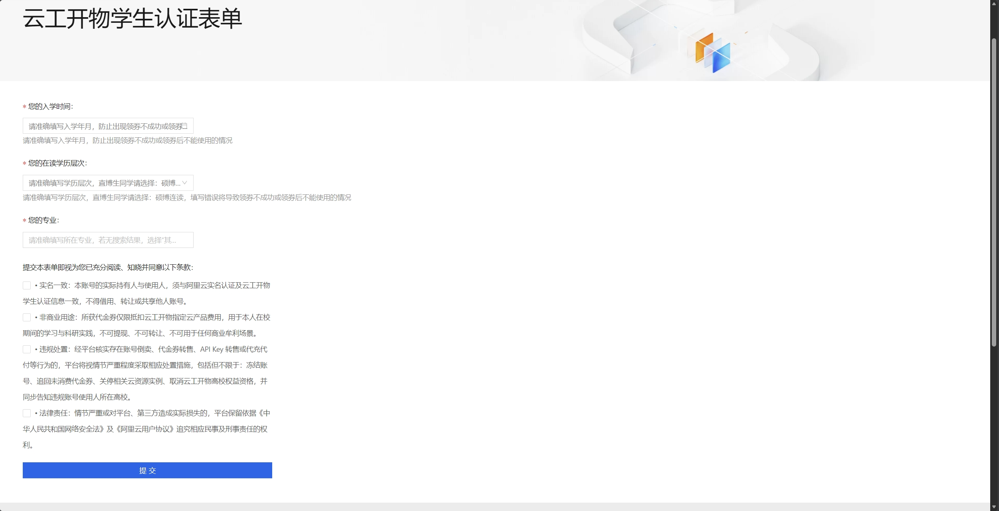

### 步骤 4｜确认领取成功

提交后回到云工开物页面，弹出绿色对勾提示 **「领取成功」**：

> 恭喜您，领取成功，可前往费用与成本-卡券管理进行查看！

点击右侧蓝色 **「立即查看」** 直接跳转（点「取消」也可以，稍后自己去控制台查）。

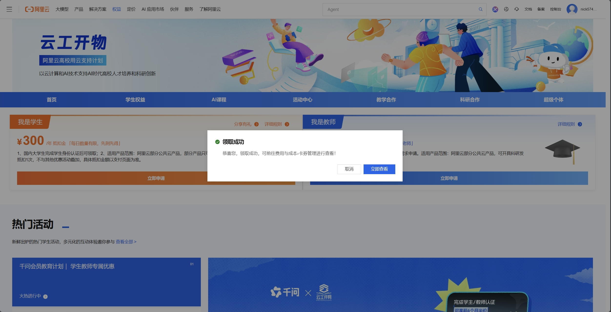

### 步骤 5｜在控制台核对代金券到账

进入控制台 **「费用与成本」→ 左侧「账户」→「卡券」→「优惠券」** 标签页，列表中应看到一条：

| 字段     | 值                   |
| ------ | ------------------- |
| 面额     | ¥300                |
| **余额** | **¥300**（未使用，全额可用）  |
| 券类型    | 代金券                 |
| 适用商品   | 通用（不适用商品名单除外）       |
| 适用范围   | 全网自营                |
| 状态     | ✅ 可用                |
| 订单类型   | 阿里云预付费通用（新购、续费、降级等） |

点该行右侧 **「查看抵扣明细」** 可跟踪后续消耗。

> 两点注意：① 页面顶部提示"仅支持查询过期时间未超过 18 个月的优惠券信息"；② 这张券是**阿里云账单侧的抵扣金**，后面千问 AI 平台的按量付费走阿里云计费，因此免费额度用尽后产生的账单可由它抵扣。

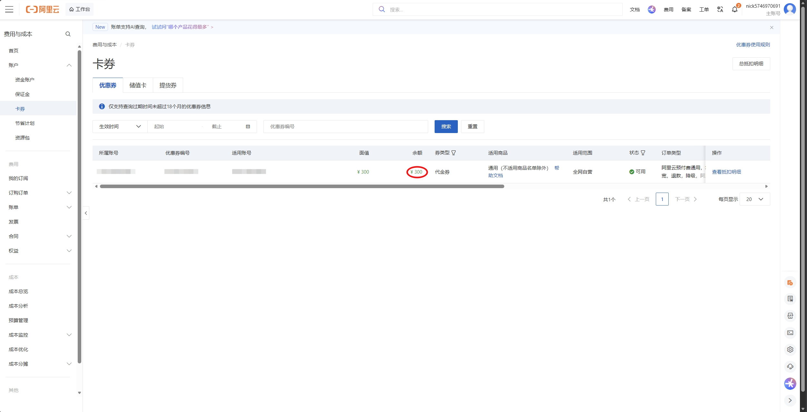

---

## 第二段：在千问 AI 平台创建 API Key

### 步骤 6｜进入千问 AI 平台

回到阿里云官网，鼠标悬停顶部导航 **「大模型」**，在下拉面板左上角点击红框标注的 **「千问 AI 平台」**（千问官方 MaaS 平台，为开发者和 Agent 而生，新用户赠送 1 亿+ tokens 额度）。

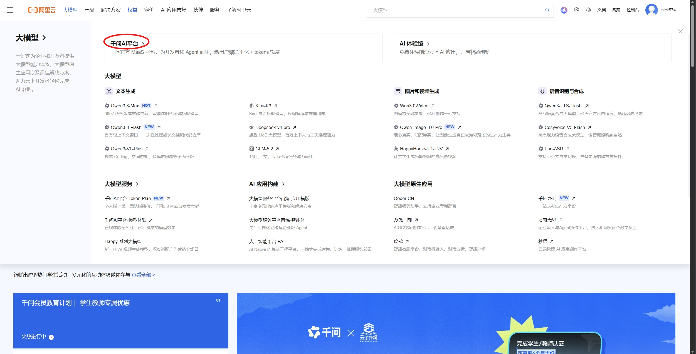

### 步骤 7｜打开 API Keys 页面

在千问 AI 平台左侧栏点击 **①「API Keys」**（集中管理访问凭证，用于模型调用身份鉴权）。

页面上方「按量付费」区块会直接给出两个 **Base URL**，先复制备用：

- **OpenAI 兼容**：`https://maas.qianwenaiapi.com/compatible-mode/v1`
- **Anthropic 兼容**：`https://maas.qianwenaiapi.com/apps/anthropic`

然后点击该区块右上角的 **②「+ 创建 API Key」**（首次进入列表为空，显示"暂无 API Key"，也可点页面中部的「创建 API Key」）。

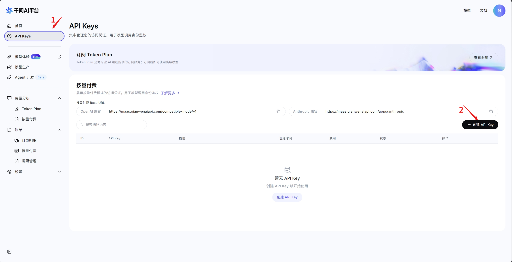

### 步骤 8｜填写描述并生成，立刻复制并保存 Key（只显示一次）

弹窗 **「复制按量付费 API Key」** 中，点击 API Key 输入框右侧的 **复制图标**，把 `sk-ws-` 开头的完整密钥复制到剪贴板，并马上粘贴到一个安全的地方（密码管理器 / 本地配置文件）。

> ⚠️ 图中红字提醒的重点：**该值仅可查看一次**。关闭此对话框后将无法再次查看完整 API Key，只能重新创建。务必先复制成功再点「关闭」。

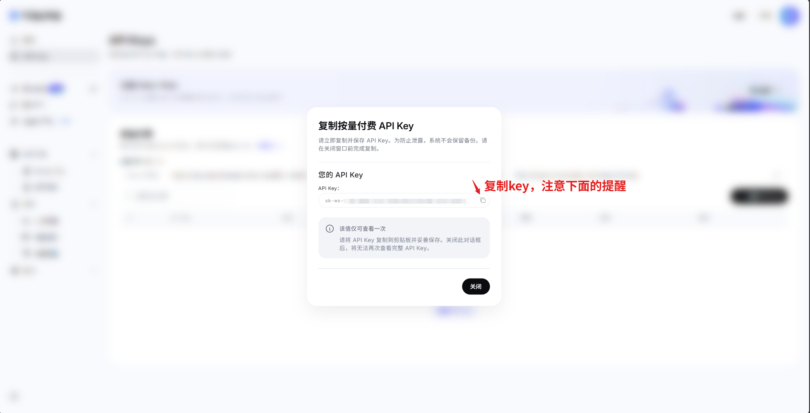

---

## 第三段：接入 DSH（DeepSeek Harness）

### 步骤 9｜打开 DSH 的模型设置

启动 DSH 客户端，点击窗口 **左下角「… 更多」** 进入 **「设置」** 面板，选择左侧 **「模型」** 标签（说明：填入各提供商的 API 密钥即可使用其模型），再点击右侧 **「+ 添加模型提供商」**。

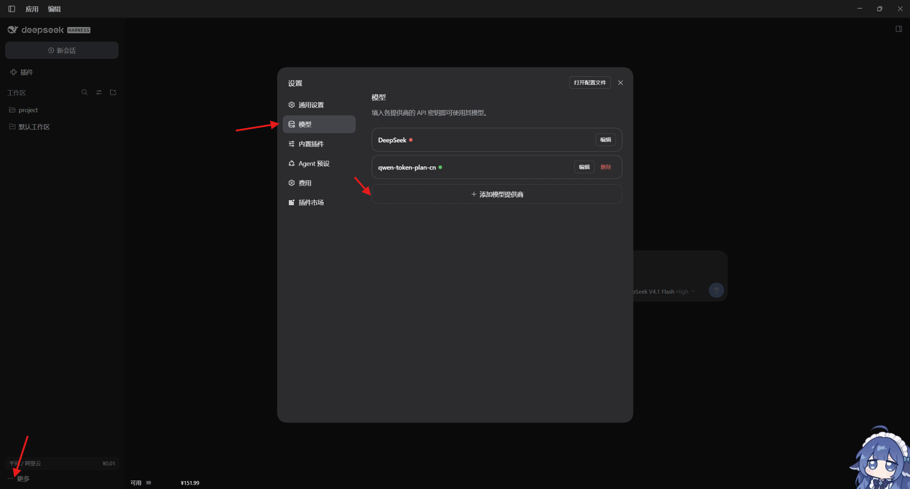

### 步骤 10｜配置提供商、密钥与 API 地址

在编辑面板的 **「第三方模型提供商」** 标签下依次操作：

1. **提供商**：下拉选择 `qwen-token-plan-cn`。
2. **API 密钥**：粘贴步骤 8 复制的 `sk-ws-…` 密钥（留空则会走环境认证）。
3. 展开 **「自定义设置」**，在 **API 地址** 中填入 OpenAI 兼容地址：  
   `https://maas.qianwenaiapi.com/compatible-mode/v1`
4. 点击 **「获取可用模型」** 拉取该 Key 实际可调用的模型目录。
5. 确认「模型目录」中已有 `deepseek-v4.1-flash`（恢复默认模型显示为 `DeepSeek V4.1 Flash`），不够可点「+ 添加模型」。
6. 点击右下角 **「保存」**。

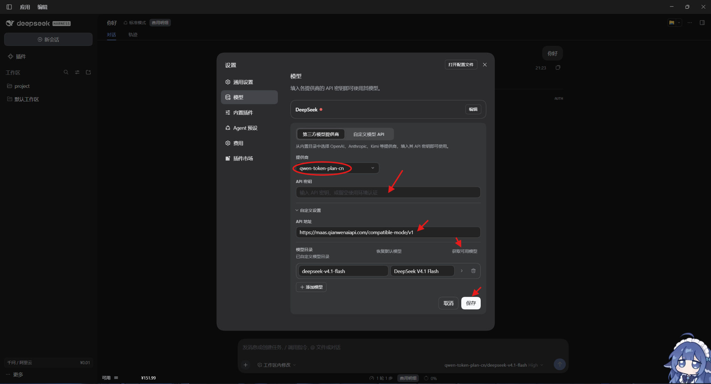

### 步骤 11｜勾选要添加的模型

点「获取可用模型」后弹出 **「选择要添加的模型」**，列出该提供商的可用模型，按需勾选（可点「取消全选」后单选，减少选择器噪音）：

`glm-5.3`、`kimi-k2.5`、`kimi-k2.6`、`kimi-k2.7-code`、`qwen3.6-flash`、`qwen3.6-plus`、`qwen3.7-max`、`qwen3.7-plus`、`qwen3.8-flash`、`qwen3.8-max` 等。

勾选完点击 **「添加所选」**，回到编辑面板后再点一次 **「保存」** 生效。

> 面板底部提示：模型选择器中不显示任何模型时，目录外的模型 ID 仍可直接发送。

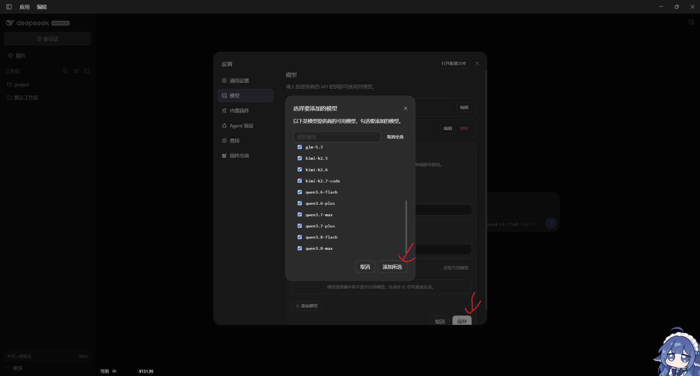

### 步骤 12｜切换模型开始使用

回到 DSH 主界面，点击输入框右下角的 **模型选择器**，在列表中找到红框标注的 **`qwen-token-plan-cn`** 分组，其下即可选择 `DeepSeek V4.1 Flash`、`GLM-5.3`、`Kimi K2.7 Code`、`Qwen3.8 Flash`、`Qwen3.8 Max` 等模型（选中项右侧有 ✓）。选好模型、设置好推理档位（如 `High`），直接发消息即走千问 AI 平台的按量计费通道。

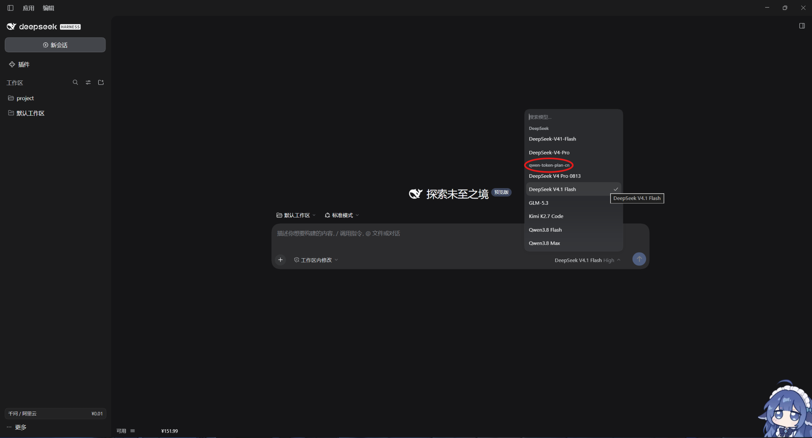

---

## 扩展

接好之后，DSH 左下角「可用」那一行只是一个合计数：300 元学生券还剩多少、什么时候到期、现在忙时还是闲时，都得登控制台翻。本仓库的插件 **dsh-aliyun-balance**（npm 同名包已上线）就是干这个的：悬浮一行 + 悬停明细卡，直读阿里云 BSS 的**当前存量**，一眼看到“还能花多少”（它不做消费统计；想看“花了多少”用互补的 dsh-cost-meter）。

悬停左下角「可用」那一行展开明细卡（图 14），**每一行都是从阿里云直接读到的，没有一个是推算的**：

- **可用合计（券 + 阿里云余额）**：¥151.99 = 券 ¥151.98 + 阿里云余额 ¥0.01；
- **现金 / 信控**：¥0.01 / ¥0.00；
- **券面值 / 已用**：¥300.00 / ¥148.02，学生券烧了多少一眼可见；
- **券失效时间**：2027-10-01，到期前记得把模型调用安排上；
- **计价时段**：忙时（较贵）· 32 分钟后转闲 —— 这是**千问平台**口径（闲时 22:00–08:00 东八区），且只对忙闲双档计价的模型（如 `deepseek-v4.1-flash`）有意义，其余模型全天同价，此行只是时刻提示，用不上可在面板关掉；
- **数据时间**：本屏数据的查询时刻。

日常操作：**单击**该行 = 绕过缓存立即刷新（余额与券本身每 5 分钟自动刷一次）；**拖动**换位置、**双击**复位；点 **☰** 打开设置面板。

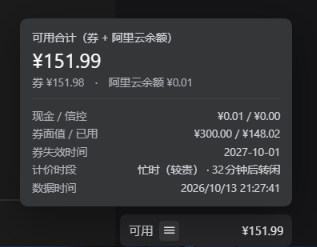

插件要查阿里云 OpenAPI，需要一对 AccessKey。**绝不要用主账号 AK** —— 主账号 AK 等于全权限，泄露了别人能替你下单、退款；正确姿势是建一个"账单只读"的 RAM 子账号。

### 步骤 14｜安装插件（桌面端用对话式安装）

DSH 桌面端读的是 `desktop` profile，而 `dsh plugin` 命令行**按设计拒绝**操作它，所以桌面端走对话式安装（实测环境 DSH Desktop 2.0.17）：

1. **拿目录**：把插件目录放到一个**固定**位置（别放临时目录，装好后移动目录需要重装），三选一：
   - `git clone https://github.com/wai549077/dsh-aliyun-balance.git`
   - 仓库页面下载 zip 解压；
   - `npm i dsh-aliyun-balance`。
2. **让 DSH 装上**：在 DSH 桌面端会话里直接说："把 D:\Plugins\dsh-aliyun-balance 这个本地目录作为插件装上"（换成你的实际路径，指含 `package.json` 的那一层）。
3. **自检**：界面上出现 `可用 ☰ ¥xx.xx` 一行；日志 `%USERPROFILE%\.dsh\.dsh-aliyun-balance.log` 里出现 `{"event":"apply"}`。**没看到那一行就重开一次客户端**（热生效实测有不完整的先例）。

不配凭据也能装：那一行会显示「未配置」，配凭据见步骤 21。（`dsh web` 的 web profile 则用命令行 `dsh plugin --profile web add dsh-aliyun-balance`。）

### 步骤 15｜从头像菜单进入 RAM 访问控制

阿里云官网点右上角**头像**，在下拉面板「权限与安全」一栏点红圈标注的 **「访问控制」**，进入 RAM 控制台。（顺路可以在下拉里看到「费用与成本 → 可用额度」和「我的权益 → 可用券」，与插件读的是同源数据。）

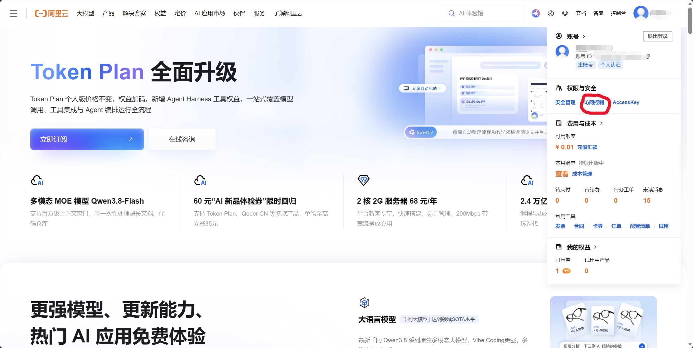

### 步骤 16｜用户页创建子账号

RAM 控制台左侧栏「身份管理」下点 **「用户」**，点列表上方蓝色 **「创建用户」** 按钮。

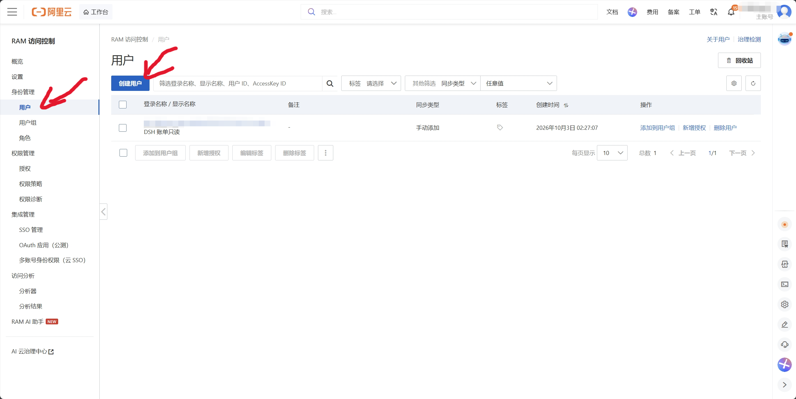

### 步骤 17｜填用户信息，只勾「永久 AccessKey」

1. **登录名称**（必填）：填如 `dsh-billing-readonly`，系统自动补 `@<账号ID>.onaliyun.com` 后缀；**显示名称**写「DSH 账单只读」便于识别。
2. **访问配置**：只勾右侧 **「使用永久 AccessKey 访问」**（创建 AccessKey ID 和 AccessKey Secret，用于 API 或其他开发工具访问）；**不要勾**「使用控制台访问」—— 不给这个子账号登录密码，权限更小，页面提示"建议启用仅一种访问方式以提高安全性"说的就是这件事。
3. 点 **「确定」**。

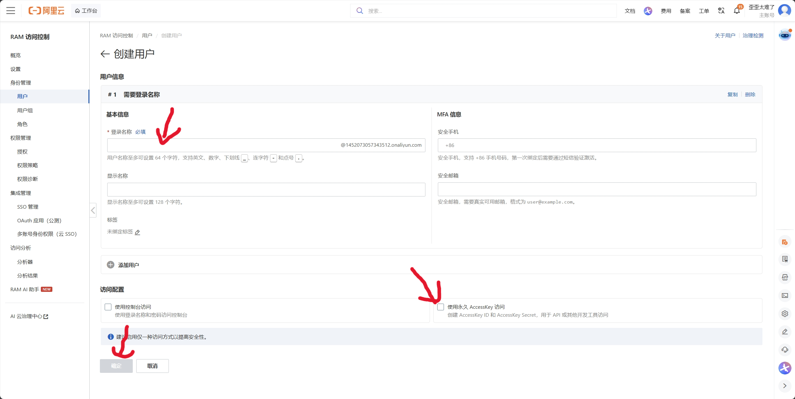

### 步骤 18｜完成安全验证

弹出 **「安全验证」**：选 **手机号验证**（或扫脸验证），点「发送验证码」，输入账号绑定安全手机收到的验证码（1 分钟未收到去垃圾短信里找），点 **「立即验证」**。

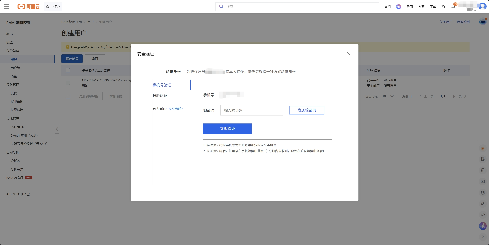

### 步骤 19｜立刻复制保存 AccessKey

创建结果页顶部黄条警告：**如果启用永久 AccessKey 访问，务必保存创建结果，页面关闭后没有任何方式再次查询 AccessKey Secret。**

在红圈的 **AccessKey** 列分别点 **「复制」**，把 **AccessKey ID**（`LTAI` 开头）和 **AccessKey Secret** 存到安全位置——后面要填进插件；也可以先点左上「保存结果」留住本页。

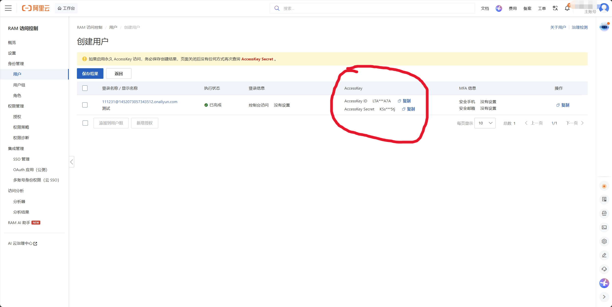

### 步骤 20｜授予 BSS 只读权限

回到用户列表，点新子账号操作列的 **「新增授权」**，右侧抽屉中：

1. **资源范围**：保持「账号级别」；
2. **授权主体**：已自动带入刚建的子账号；
3. **权限策略**：搜索框输入 `BSS` 过滤出费用类策略，勾选**只读**策略：
   - `AliyunBSSReadOnlyAccess` —— 只读访问费用与成本（BSS），**插件的最低要求**（等价于只开 `bss:DescribeAcccount`、`bss:DescribeCoupons` 两个 Action，官方原文就是双 `c`）；
   - `AliyunBSSRenewReadOnlyAccess` —— 费用与成本-续费管理只读；
   - `AliyunBSSCartReadOnlyAccess` —— 购物车查看权限策略。  
     后两条同样是纯"看"，按需加；右侧「已选择权限策略」应同步列出所勾的系统策略；
4. 点 **「确认新增授权」**。

> 底线：只勾 **ReadOnly** 系。插件只查余额与代金券两类接口，有这些权限它只能"看"账单、券和购物车，**不能下单、不能退款、不能动资源**——AK 万一泄露损失也可控。切勿图省事勾 `AliyunBSSFullAccess`、`AliyunBSSOrderAccess`、`AliyunBSSRefundAccess` 这类。

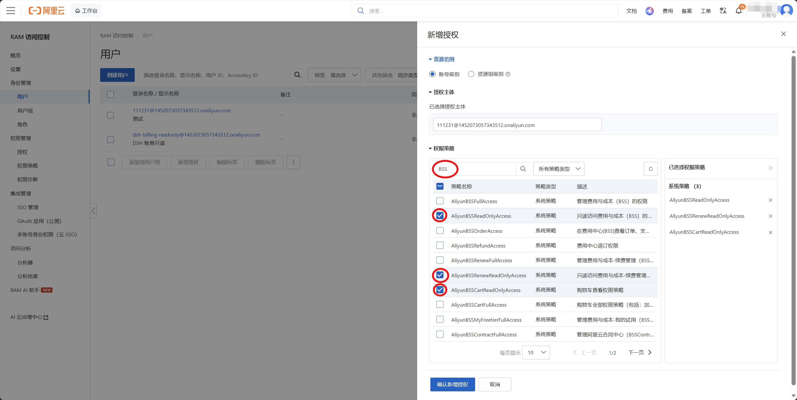

### 步骤 21｜插件面板填凭据并测试连接

1. 点「可用」那一行的 **☰** 打开面板，展开 **「凭据与设置」**（行右摘要会显示 `AK·SK 已配置` / 未配置）；
2. 把步骤 19 存好的 AccessKey ID、AccessKey Secret 填进对应输入框（**留空则不覆盖已保存的值**，方便只改其中一个），点 **「保存凭据」** —— 提交后输入框即清空；
3. 点 **「测试连接」**，下方出现绿色 **「刷新完成」** 即链路通了；余额与券**每 5 分钟自动刷新**，也可点 **「立即刷新」**。

> ⚠️ 凭据是**明文落盘**的：插件把 AK/SK 写进 DSH 官方凭据服务，本地文件 `~/.dsh/.credentials.yaml` 为明文 YAML（靠文件权限保护）。所以两条铁律：**只放只读子账号的 AK**；插件设置接口**永不回显**密钥，只返回"有没有配"。

面板另两行按需：**「外观与挂件」**（锁定位置、背景/文字色、不透明度、隐藏边框、恢复默认外观，自定义只作用于那一行）；**「计价时段」** 总开关（控制悬停明细里要不要显示时段行）。

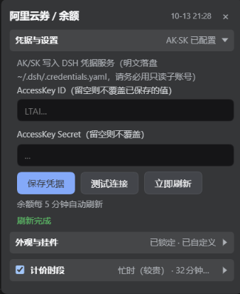

### 扩展排障速查

| 现象             | 处理                                                                            |
| -------------- | ----------------------------------------------------------------------------- |
| 装完没出现那一行       | 重开一次客户端；看 `%USERPROFILE%\.dsh\.dsh-aliyun-balance.log` 有无 `{"event":"apply"}` |
| 那一行显示「未配置」     | 按步骤 15–21 配只读子账号 AK，用面板「测试连接」验证                                               |
| 查余额报 Forbidden | RAM 子账号缺 `bss:Describe*` / `bss:Query*` 只读权限，回步骤 20 补勾                        |
| 挂件位置乱了         | 双击那一行复位；若勾了「锁定位置」先取消锁定                                                        |

配完收工：学生券还剩多少、何时到期、现在贵不贵，DSH 左下角 glance 一眼就知道，不用再登控制台翻卡券页。
